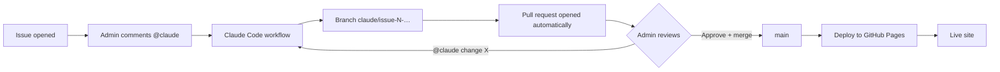

# Setting up issue-to-deploy automation with Claude

This guide sets up a GitHub repository so that:

1. Anyone opens an **issue** describing a bug or a change.
2. A repo admin comments **`@claude`** on it. GitHub Actions runs Claude, which writes the fix on a new branch.
3. The workflow opens a **pull request** for that branch automatically.
4. The admin **reviews, approves and merges** the PR. Nothing reaches `main` without that step.
5. The merge triggers a **deploy to GitHub Pages**.

It's written for a static site with no build step (HTML, CSS, JavaScript), like this repo. The same setup works for other projects if you change the deploy workflow.



---

## Before you start

You need:

| What | Why |
|---|---|
| A GitHub account that **owns or administers** the repo | Only admins can install apps, add secrets and set branch rules |
| An **Anthropic API key** from [console.anthropic.com](https://console.anthropic.com) (or a Claude Pro/Max plan) | Claude's runs are billed to it |
| A public repo, or a private one on a GitHub plan that includes Pages | GitHub Pages hosting |

> **Use the right account.** Every step below must be done while signed in as the repo owner or an admin. If you're signed in as a collaborator without admin rights, the Settings pages and options below are missing or greyed out. Check the avatar at the top right of GitHub.

The whole setup takes about 20 minutes.

---

## Step 1: Create the repo and add the site

1. Create the repository on GitHub, for example `owner/Calculator`.
2. Add the site files at the root: `index.html`, `styles.css`, `app.js` and so on.
3. Push them to `main`. Do this **before** adding branch rules in step 8, so you can push directly.

## Step 2: Add a `CLAUDE.md`

Claude reads `CLAUDE.md` at the repo root before every task. Use it to state the rules you'd give a new contributor: stack, conventions, how to check work, and how deploys work. Short and specific beats long.

The one in this repo:

```markdown
# FinTechCo Calculator

Mortgage and compound-interest calculator. Static site: `index.html`, `styles.css`, `app.js`,
with Chart.js loaded from cdnjs. No build step, no package.json, no backend.

## Working on it
- Keep it plain HTML/CSS/JavaScript. Don't add frameworks, bundlers or npm dependencies.
- All colors are CSS tokens on `:root` with dark-mode overrides; use tokens, not literal colors.
- Check syntax with `node --check app.js` before committing.

## Deploys
Every push to `main` deploys via `.github/workflows/deploy.yml`. Only `index.html`, `styles.css`
and `app.js` are published; if you add a file the page needs, add it to the copy step there too.
```

## Step 3: Install the Claude GitHub app

1. Go to **https://github.com/apps/claude** and click **Install** (or **Configure**).
2. Choose the account that owns the repo.
3. Select **Only select repositories** and pick your repo.
4. Approve the requested permissions (contents, issues, pull requests).

## Step 4: Add the API key as a secret

1. Open `https://github.com/<owner>/<repo>/settings/secrets/actions`.
   In the menus: repo **Settings** tab → left sidebar, under **Security** → **Secrets and variables** → **Actions**.
2. Click **New repository secret**.
3. Name: `ANTHROPIC_API_KEY`. Value: your key. Click **Add secret**.

If you have a Claude Pro or Max plan, you can run `claude setup-token` locally and store the result as `CLAUDE_CODE_OAUTH_TOKEN` instead. Then change `anthropic_api_key` to `claude_code_oauth_token: ${{ secrets.CLAUDE_CODE_OAUTH_TOKEN }}` in the workflow.

Make sure the URL contains your repo name. `github.com/settings/...` is your personal account settings, which is the wrong place.

## Step 5: Let GitHub Actions open pull requests

1. Go to **Settings → Actions → General**.
2. Under **Workflow permissions**, select **Read and write permissions**.
3. Tick **Allow GitHub Actions to create and approve pull requests**.
4. Click **Save**.

Without step 3, Claude's fix is pushed to a branch but no PR appears.

## Step 6: Turn on GitHub Pages

1. Go to **Settings → Pages**.
2. Under **Build and deployment → Source**, choose **GitHub Actions**.

The site will be served at `https://<owner>.github.io/<repo>/`.

## Step 7: Add the two workflows

Create these files and push them to `main`.

### `.github/workflows/claude.yml`: Claude fixes issues and opens a PR

```yaml
name: Claude Code

# Mention @claude in an issue (title or body) or in a comment, and Claude
# works on it, pushes a branch and opens a pull request for review.
on:
  issues:
    types: [opened, assigned]
  issue_comment:
    types: [created]
  pull_request_review_comment:
    types: [created]
  pull_request_review:
    types: [submitted]

jobs:
  claude:
    # Only people with write access can trigger Claude, so strangers on a
    # public repo can't spend the API key.
    if: |
      contains(fromJSON('["OWNER","MEMBER","COLLABORATOR"]'),
        github.event.comment.author_association || github.event.review.author_association || github.event.issue.author_association) &&
      (
        (github.event_name == 'issues' && (contains(github.event.issue.title, '@claude') || contains(github.event.issue.body, '@claude'))) ||
        (github.event_name == 'issue_comment' && contains(github.event.comment.body, '@claude')) ||
        (github.event_name == 'pull_request_review_comment' && contains(github.event.comment.body, '@claude')) ||
        (github.event_name == 'pull_request_review' && contains(github.event.review.body, '@claude'))
      )
    runs-on: ubuntu-latest
    timeout-minutes: 30
    permissions:
      contents: write
      pull-requests: write
      issues: write
      id-token: write
      actions: read
    steps:
      - name: Check out repository
        uses: actions/checkout@v6
        with:
          fetch-depth: 1

      - name: Run Claude
        uses: anthropics/claude-code-action@v1
        with:
          anthropic_api_key: ${{ secrets.ANTHROPIC_API_KEY }}
          claude_args: |
            --allowedTools "Bash(node --check:*),Bash(node:*)"
            --append-system-prompt "Follow CLAUDE.md. A later workflow step opens the pull request for your branch, so you don't need to."

      # On issues, Claude pushes a claude/issue-<N>-<timestamp> branch but only
      # posts a "Create PR" link. Open the PR here so it's ready for review.
      - name: Open pull request for Claude's branch
        if: github.event_name == 'issues' || (github.event_name == 'issue_comment' && !github.event.issue.pull_request)
        env:
          GH_TOKEN: ${{ github.token }}
          ISSUE: ${{ github.event.issue.number }}
          ISSUE_TITLE: ${{ github.event.issue.title }}
        run: |
          branch=$(git ls-remote --heads origin "claude/issue-${ISSUE}-*" | awk '{print $2}' | sort | tail -1 | sed 's#^refs/heads/##')
          if [ -z "$branch" ]; then
            echo "Claude pushed no branch for issue #${ISSUE}; nothing to open."
            exit 0
          fi
          if [ -n "$(gh pr list --head "$branch" --state all --json number --jq '.[].number')" ]; then
            echo "A pull request for $branch already exists."
            exit 0
          fi
          gh pr create --base main --head "$branch" \
            --title "$ISSUE_TITLE" \
            --body "Fixes #${ISSUE}

          Claude's changes for issue #${ISSUE}. Claude's comment on the issue explains what changed and what wasn't checked."
```

What each part does:

- **Triggers:** an issue opened or assigned, a comment, or a PR review. The job only runs when the text contains `@claude`.
- **Author check:** only the owner, org members and collaborators can trigger it. On a public repo this stops strangers from running up your API bill. Anyone can still *open* an issue; an admin then comments `@claude` to start the fix.
- **`--allowedTools`:** the shell commands Claude may run. Here it's only `node`, for syntax checks. Add your test command if you have one, for example `Bash(npm test)`.
- **Last step:** the Claude action pushes a `claude/issue-N-…` branch but, on issues, only posts a "Create PR" link. This step opens the PR itself, with `Fixes #N` so merging closes the issue.

### `.github/workflows/deploy.yml`: publish `main` to GitHub Pages

```yaml
name: Deploy to GitHub Pages

on:
  push:
    branches: [main]
  workflow_dispatch:

permissions:
  contents: read
  pages: write
  id-token: write

concurrency:
  group: pages
  cancel-in-progress: false

jobs:
  deploy:
    runs-on: ubuntu-latest
    environment:
      name: github-pages
      url: ${{ steps.deployment.outputs.page_url }}
    steps:
      - name: Check out repository
        uses: actions/checkout@v6

      - name: Check script syntax
        run: node --check app.js

      - name: Collect site files
        run: |
          mkdir _site
          cp index.html styles.css app.js _site/

      - name: Configure Pages
        uses: actions/configure-pages@v5

      - name: Upload site
        uses: actions/upload-pages-artifact@v3
        with:
          path: _site

      - name: Deploy
        id: deployment
        uses: actions/deploy-pages@v4
```

Merging a PR is a push to `main`, so every merge deploys. `workflow_dispatch` adds a **Run workflow** button in the Actions tab for redeploying by hand. The **Collect site files** step publishes only the listed files, so repo files such as `.github/` and `CLAUDE.md` stay off the site. If you're adapting this to a project with a build step, replace that step with your build and point `path` at the build output.

Pushing these files runs the first deploy straight away, so finish steps 5 and 6 first.

## Step 8: Require review before anything reaches `main`

This is the step that makes the admin the gatekeeper.

1. Go to **Settings → Rules → Rulesets → New ruleset → New branch ruleset**.
2. **Ruleset name:** `Protect main`.
3. **Enforcement status:** **Active**. A disabled ruleset does nothing.
4. **Target branches:** click **Add target → Include default branch**.
   If you skip this you'll see *"This ruleset does not target any resources and will not be applied."*
5. **Bypass list:** click **Add bypass → Repository admin** and set it to **Always allow**.
   This lets the admin merge their *own* PRs. GitHub never lets an author approve their own PR, so without a bypass an admin's PRs can't be merged at all.
6. **Rules:** tick
   - **Restrict deletions**
   - **Block force pushes**
   - **Require a pull request before merging**, with **Required approvals: 1**
7. Click **Create**.

Leave **Allow auto-merge** off under **Settings → General** if you want to merge each PR by hand.

Claude's PRs are opened by a bot account, so the admin *can* approve them normally. The bypass only matters for PRs the admin opens.

## Step 9: Test it end to end

1. Open an issue: *"Change the footer text to 'Built with Claude'"*.
2. Comment on it: `@claude please fix this`.
3. Within about a minute, Claude replies on the issue with a progress checklist. Follow the live run under **Actions → Claude Code**.
4. When it finishes (usually 2–5 minutes), a PR titled after the issue appears under **Pull requests**.
5. Review it in **Files changed** → **Review changes → Approve → Submit review** → **Merge pull request**.
6. Watch **Actions → Deploy to GitHub Pages**. When it's green, reload the site.

---

## Day-to-day use

| You want to… | Do this |
|---|---|
| Get Claude to fix an issue | Comment `@claude please fix this` on the issue, or put `@claude` in the issue when you open it |
| Ask for changes to Claude's PR | Comment on the PR: `@claude make the button smaller` |
| Try a PR before merging | `git fetch origin && git checkout <branch>`, then `python3 -m http.server 5173` and open http://localhost:5173 |
| Reject a fix | Close the PR without merging; delete the branch |
| Redeploy without changes | **Actions → Deploy to GitHub Pages → Run workflow** |
| Undo a bad deploy | Open the merged PR and click **Revert**, then merge the revert PR |

## Troubleshooting

| Symptom | Cause and fix |
|---|---|
| Nothing happens after `@claude` | The workflow files aren't on `main` yet, or the comment came from someone without write access. Check the **Actions** tab. An issue opened *before* the workflow existed won't trigger it; add a new `@claude` comment |
| Claude Code run is red | Usually a missing or wrong `ANTHROPIC_API_KEY`, or the Claude app isn't installed on this repo. Open the run's logs |
| Run shows **Skipped** | Expected when the event didn't mention `@claude` (for example a plain PR review). Not an error |
| Claude finished but no PR | **Allow GitHub Actions to create and approve pull requests** is off (step 5). The issue comment still has a **Create PR ➔** link you can use |
| `git push` returns 403 | Your local git is signed in as an account without write access. Use a token from the owner account, or add yourself as a collaborator |
| `git push` says *Changes must be made through a pull request* | The ruleset is working. Push to a branch and open a PR |
| **Merge pull request** is greyed out on your own PR | You can't approve your own PR. Add **Repository admin** to the ruleset's bypass list, then tick **Merge without waiting for requirements to be met** |
| *"This ruleset does not target any resources"* | Add a target branch (step 8, item 4) |
| Can't find **Secrets and variables** | You're not signed in as an admin, or you're in personal settings. Use the direct URL in step 4 |
| Site deployed but a new file 404s | The deploy only copies the files listed in **Collect site files**. Add the new file there |

## Cost and safety

- **Cost:** each Claude run uses API credits, typically cents to a few dollars depending on the size of the change. Set a monthly spend limit in the Anthropic Console.
- **Who can trigger Claude:** only owners, members and collaborators (the `author_association` check).
- **What Claude can change:** only branches. It can't push to `main`, because the ruleset requires a reviewed PR.
- **What reaches users:** only what an admin merges.
- **Secrets:** the API key lives in GitHub's encrypted secrets and never appears in logs or commits.
